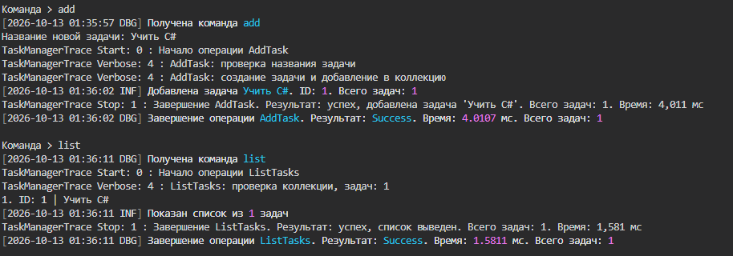
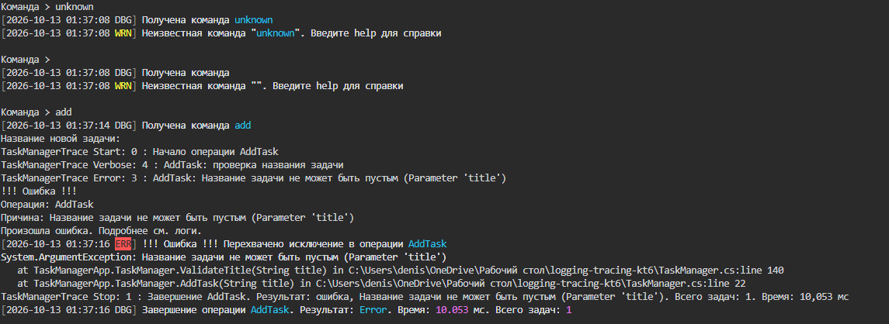
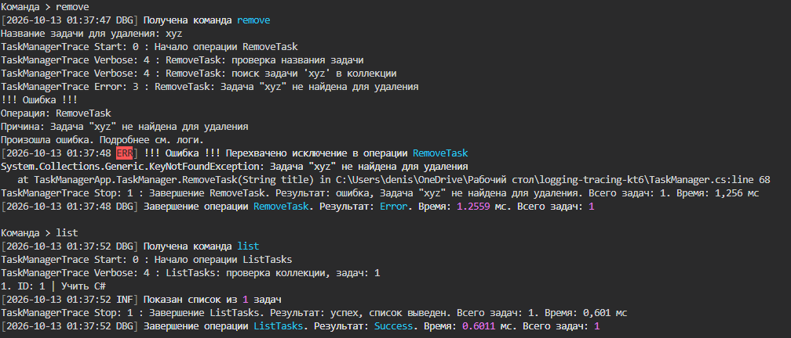
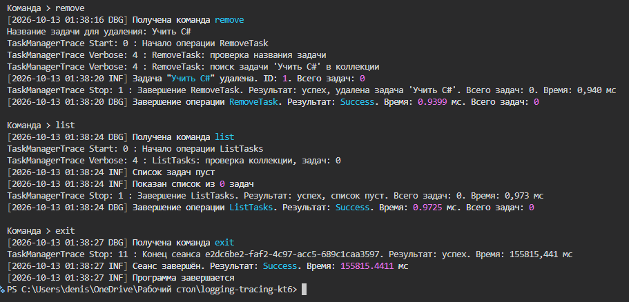
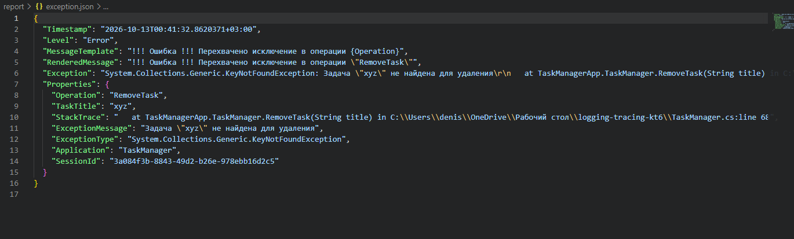
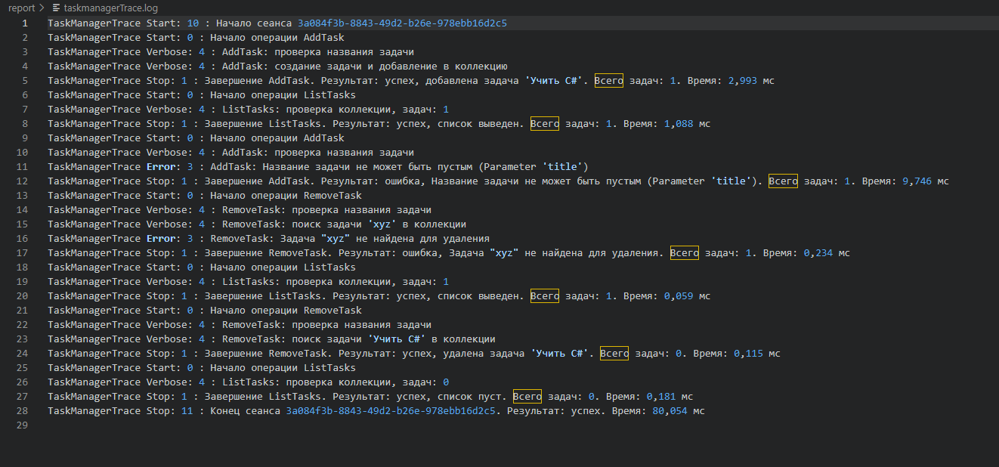
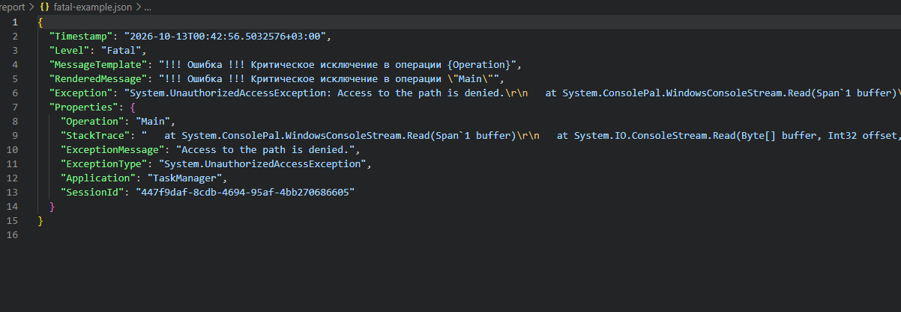

# КТ-6 - Итоговая интеграция логирования и трассировки в проект TaskManager

Студент - Денисенко Даниил Евгеньевич  
Группа - 4п4.23 NET  
Дисциплина - Логирование и трассировка C#  

### Задания

Задание «КТ 6. Итоговая интеграция логирования и трассировки в проект TaskManager »

Полностью интегрировать в свой проект TaskManager все аспекты, изученные ранее:
Базовое логирование (1.1–1.3).
Продвинутое логирование (Serilog / NLog) (2.1–2.3).
Трассировка (TraceSource, Stopwatch) (3.1–3.2).
Логирование ошибок и исключений (3.3).

В результате получится полноценный проект TaskManager, который управляет задачами (добавляет, удаляет, выводит список), и подробно фиксирует все ключевые события, ошибки, время выполнения, контекст

### Задание 1

Добавил создание, удаление и вывод задач
В списке видны ID и название, пустые названия не принимаются

Задача «Учить C#» добавлена и показана в списке с ID 1

Программа сообщает о неизвестной команде и не принимает пустое название

Задача «xyz» не найдена, список остался прежним

Список пуст, программа завершена командой exit

### Задание 2

Настроил Serilog для вывода сообщений в консоль и JSON-файл
В логах сохраняются время, действие, результат и ошибки

В логе видны ошибка, операция и стек вызовов

### Задание 3

Добавил трассировку через TraceSource и замер времени через Stopwatch
Записываются шаги операций, их начало и конец, а также завершение программы

В файле видны начало и конец работы, результаты и время операций

### Задание 4

Добавил обработку исключений и сообщение «!!! Ошибка !!!»
Обычные ошибки записываются как Error, после них можно продолжить работу
При критической ошибке записывается Fatal и программа завершается

Критическая ошибка чтения ввода записана с уровнем Fatal

